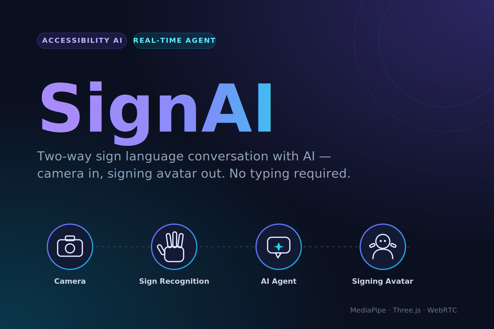
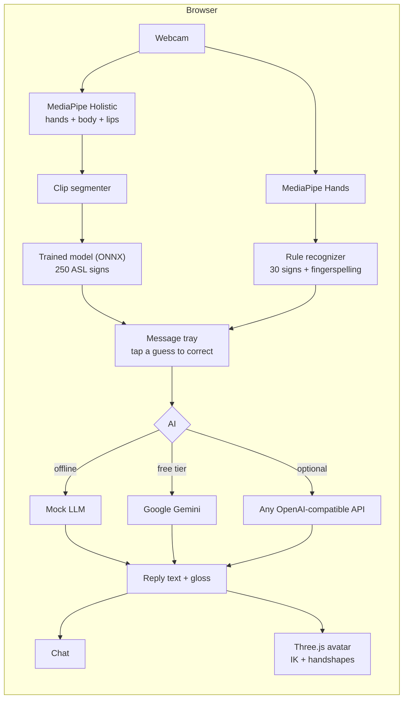

# SignAI

**Talk to an AI in sign language.** Your webcam reads your signs, a chat model replies, and a 3D avatar signs the answer back. No typing needed on either side.

A personal side project. Everything runs in the browser, and the camera feed never leaves your device.



---

## Try it

**Live demo: https://samadbekyunusalievv.github.io/signai/** (GitHub Pages, published from `main`)

**Just open [`signai.html`](signai.html) in a browser.** It's one self-contained file (all CSS and JS inlined), so you can double-click it, copy it anywhere, or send it to someone. No server, no install. Allow the camera when the browser asks.

It needs an internet connection, to load MediaPipe, Three.js and onnxruntime-web from a CDN and the trained sign model from GitHub Pages.

No camera? Click the signs under the video, or type in the chat box.

### Developing

The readable source is `index.html` + `css/` + `js/`. `index.html` also opens directly, as long as its folders sit next to it. After editing, regenerate the single file:

```bash
npm run build    # rebuilds signai.html
npm test
```

## How it works



There are three recognition modes:

| Mode | What it reads | How |
|---|---|---|
| **AI · 250 signs** (default) | 250 everyday ASL signs | A neural network trained on Google's ASL dataset (see [Training](#training-the-sign-model)) |
| **Basic** | 30 signs | Hand-written rules over hand landmarks |
| **Letters** | Fingerspelling A B C D E F H I L O S U V W Y | Hand-written rules |

In **AI** mode, sign one word, then lower your hands or hold still. The model reads the whole movement and adds its best guess to your message. Its top guesses are shown under the video; tap one if it picked the wrong word.

1. **Hand tracking.** MediaPipe Hands finds 21 3D landmarks per hand, for up to two hands, on-device.
2. **Recognition** (`js/recognizer.js`):
   - Finger states come from 3D joint angles in world landmarks, so they hold up when your hand is tilted, rotated, or far from the camera.
   - Each sign gets a fuzzy score from 0 to 1. The best match wins, and you see its confidence plus the runner-ups.
   - Landmarks are smoothed between frames, and a short voting window plus a hold timer stop single noisy frames from firing.
   - The last second of hand movement is tracked. That catches waves, nods, circles, downward strokes and open/close flapping, so moving signs like HELLO, YES, PLEASE, THANK-YOU and BYE work, as do two-handed signs like HELP, WHAT, MORE and NAME.
3. **Message tray.** Recognized signs build up into a message, which sends automatically when you pause and lower your hands. You can also press Send, ⌫ or ✕.
4. **Reply.** The offline mock LLM runs by default; you can switch to any OpenAI-compatible API. Either way the reply comes back as English text plus a gloss: a list of sign tokens and fingerspelled letters.
5. **Avatar** (`js/avatar.js`):
   - Two-bone IK puts the hands at real body locations (chin, chest, forehead, ear).
   - Hand orientation and handshapes are set per keyframe, with two-joint fingers and a thumb.
   - Words without a sign are fingerspelled.

## Vocabulary

**AI mode: 250 signs** from Google's Isolated Sign Language Recognition dataset. They're everyday words chosen for a children's learning game: family (mom, dad, grandma), feelings (happy, sad, mad, sleepy), needs (water, hungry, thirsty, sick, potty), animals, food, colors, time words (now, later, tomorrow, yesterday), questions (where, who, why), yes / no / please / thank you, and more. The full list is searchable in the app.

**Basic mode: 30 words**:

| Group | Signs |
|---|---|
| Social | hello · goodbye · thank you · please · sorry · I love you · nice to meet you |
| Answers | yes · no · OK · good · bad |
| People | you · me |
| Questions | what · where · name · think |
| Needs | help · water · eat · drink · hungry · more · stop/wait · call |
| Numbers & fun | one · two · three · four · rock on |

**Fingerspelling** (Letters mode): the camera reads A B C D E F H I L O S U V W Y. Other letters can be clicked. The avatar can fingerspell all 26 letters, though some are approximate.

Hover over any sign in the app to see how to make it for the camera.

## The mock LLM

`js/mock-llm.js` is an offline dialogue engine, so the app is fully usable without an API key:

- **Understands signed gloss and typed English.** It handles slang and contractions ("u", "im", "thx"), and splits a message into several intents ("hi, my name is Sam" → greet + remember name).
- **Remembers context:**
  - your name, including one you fingerspelled: ME NAME S-A-M
  - your mood
  - what it just asked you, so a bare YES or NO after "Would you like water?" is understood
- **Built-in tools:**
  - time and date
  - arithmetic ("what is 12 times 3", "2+2")
  - counting
  - jokes
  - sign lessons: "how do I sign water" makes the avatar sign it, and unknown words are fingerspelled
- **Handles needs:** help, water, food, a call to someone (simulated), with follow-up questions.
- **Varies its wording** so it doesn't repeat itself, and says plainly when something needs the internet (weather, news).

### Using a real AI

**Gemini (free tier):** get a free key at [aistudio.google.com/apikey](https://aistudio.google.com/apikey), then in the app click **⚙️ → Gemini (free tier)**, paste the key and click **Use Gemini**. The app lists the models your key can use and picks the newest Flash model. The free tier has rate limits, and Google may use free-tier conversations to improve its products.

**Other API:** any OpenAI-compatible server, such as OpenAI, OpenRouter, Groq, a local [Ollama](https://ollama.com) (`http://localhost:11434/v1`) or LM Studio. Enter a base URL, model and key.

What the real AI gets:
- **Your signs plus the recognizer's runner-up guesses**, for example `WATER[or: WHERE] THINK[or: ONE]`, so it can repair a misread sign from context.
- **Instructions to answer simply**, in 1–3 short, plain sentences, for people who find written English hard.

It replies with JSON: what it understood (shown in the chat), the reply, and a gloss the avatar can sign. If the API fails, the app falls back to the mock.

Keys are kept in your browser and only sent to that provider. Never put a key in the code: the site and repo are public.

## Project structure

```
signai/
├── signai.html             ← the whole app in one file (generated, open this)
├── index.html              app shell (source)
├── css/style.css
├── js/
│   ├── vocab.js            words, letters, hints, gloss helpers
│   ├── recognizer.js       landmarks → features → scored signs → stable output
│   ├── mock-llm.js         offline dialogue engine
│   ├── avatar.js           Three.js avatar: IK, handshapes, sign clips
│   ├── sign-model.js       trained model: preprocessing, clip segmenter, ONNX runner
│   └── app.js              wiring: camera, tray, chat, settings
├── tests/
│   ├── synthetic-hand.js   kinematic hand model that generates fake landmarks
│   ├── recognizer.test.js  every sign × (normal, tilted, far + noisy)
│   ├── mock-llm.test.js    scripted conversations
│   └── sign-model.test.js  JS preprocessing == Python preprocessing (fixtures)
├── models/                 sign-model.onnx + labels (trained, ~4 MB)
├── training/               dataset builder, training script, shared preprocessing
├── tools/build-single.js   inlines everything into signai.html
└── docs/                   older write-ups: architecture, pitch deck, research
```

## Tests

```bash
npm test
```

The recognizer tests don't need a camera. A small kinematic hand model in `tests/synthetic-hand.js` generates landmarks for each handshape and movement. Each static sign is also checked tilted, smaller and noisier.

## Training the sign model

The AI mode's model is trained on [Google's Isolated Sign Language Recognition dataset](https://www.kaggle.com/competitions/asl-signs) (Kaggle, about 94,000 clips of 250 signs from 21 signers, recorded as MediaPipe Holistic landmarks).

1. **Data:** `training/fetch.py` streams the 40 GB zip and keeps only the hands, arms and lips: 2.3 GB.
2. **Preprocessing** (`training/prep.py`, mirrored exactly in `js/sign-model.js`):
   - the dominant hand is moved to one side, mirroring left-handed signing
   - only frames with hands are kept, resampled to at most 32 frames
   - coordinates are normalized
3. **Model:** a small 1D-conv + self-attention network (~0.9 M parameters, 3.8 MB ONNX), trained on CPU with augmentation (speed, rotation, scale, shear, dropped hand/lips).
4. **Accuracy on 2 signers the model never saw:** *being measured (training in progress)*.

To retrain, accept the competition rules on Kaggle, set up the Kaggle API, then:

```bash
pip install kaggle numpy pandas pyarrow stream-unzip torch onnx onnxruntime
python training/fetch.py            # download + compact (needs ~3 GB RAM headroom)
python training/build_dataset.py
python training/train.py --epochs 40 --holdout 2 --out models
python training/make_fixture.py     # only if you change the preprocessing
```

## Limitations

- It reads **isolated signs**, one word at a time, not continuous signing, and it ignores facial grammar.
- The AI model knows 250 everyday words. Anything else needs fingerspelling, or the AI working out your meaning from context.
- Some signs are simplified versions of real ASL so a single camera can tell them apart. The hints in the app describe what the recognizer expects.
- The avatar is a simple primitive rig, so its signs are readable approximations rather than fluent ASL.
- This is a personal learning project, not an accessibility product. Real sign-language tools should be built with Deaf signers.

## Ideas / roadmap

- [x] Train a neural classifier on recorded landmarks (250 signs)
- [ ] Calibration step: record your own version of each sign to fine-tune the model
- [ ] Bigger vocabulary (e.g. ASL Citizen, about 2,700 signs) and continuous signing
- [ ] More letters (motion letters J and Z) and numbers 5–10
- [ ] Glossy rigged glTF avatar with facial expressions
- [ ] PWA / mobile layout polish

## License

MIT, see `LICENSE`.
