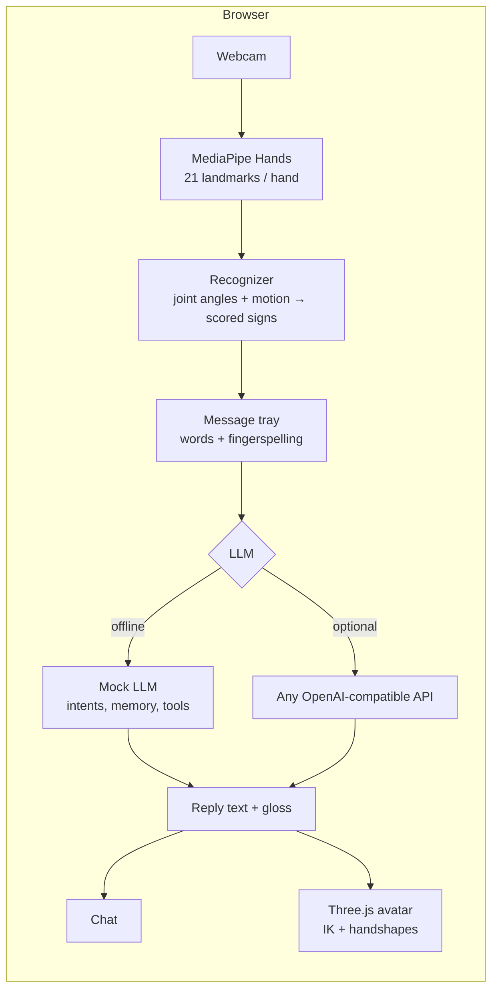

# SignAI

**Talk to an AI in sign language.** Your webcam reads your signs, a chat model replies, and a 3D avatar signs the answer back. No typing needed on either side.

A personal side project. Everything runs in the browser, and the camera feed never leaves your device.


---

## Try it

**Live demo: https://samadbekyunusalievv.github.io/signai/** (deployed automatically from `main` by GitHub Actions)

**Just open [`signai.html`](signai.html) in a browser.** It's one self-contained file (all CSS and JS inlined), so you can double-click it, copy it anywhere, or send it to someone. No server, no install. Allow the camera when the browser asks.

It needs an internet connection the first time, to load MediaPipe Hands and Three.js from a CDN.

No camera? Click the signs under the video, or type in the chat box.

### Developing

The readable source is `index.html` + `css/` + `js/`. `index.html` also opens directly, as long as its folders sit next to it. After editing, regenerate the single file:

```bash
npm run build    # rebuilds signai.html
npm test
```

## How it works



1. **Hand tracking.** MediaPipe Hands finds 21 3D landmarks per hand, for up to two hands, on-device.
2. **Recognition** (`js/recognizer.js`):
   - Finger states come from 3D joint angles in world landmarks, so they hold up when your hand is tilted, rotated, or far from the camera.
   - Each sign gets a fuzzy score from 0 to 1. The best match wins, and you see its confidence plus the runner-ups.
   - Landmarks are smoothed between frames, and a short voting window plus a hold timer stop single noisy frames from firing.
   - The last second of hand movement is tracked. That catches waves, nods, circles, downward strokes and open/close flapping, so moving signs like HELLO, YES, PLEASE, THANK-YOU and BYE work, as do two-handed signs like HELP, WHAT, MORE and NAME.
3. **Message tray.** Recognized signs build up into a message, which sends automatically when you pause and lower your hands. You can also press Send, ⌫ or ✕.
4. **Reply.** The offline mock LLM runs by default; you can switch to any OpenAI-compatible API. Either way the reply comes back as English text plus a gloss: a list of sign tokens and fingerspelled letters.
5. **Avatar** (`js/avatar.js`):
   - Two-bone IK puts the hands at real body locations (chin, chest, forehead, ear).
   - Hand orientation and handshapes are set per keyframe, with two-joint fingers and a thumb.
   - Words without a sign are fingerspelled.

## Vocabulary

**30 words** (Words mode):

| Group | Signs |
|---|---|
| Social | hello · goodbye · thank you · please · sorry · I love you · nice to meet you |
| Answers | yes · no · OK · good · bad |
| People | you · me |
| Questions | what · where · name · think |
| Needs | help · water · eat · drink · hungry · more · stop/wait · call |
| Numbers & fun | one · two · three · four · rock on |

**Fingerspelling** (Letters mode): the camera reads A B C D E F H I L O S U V W Y. Other letters can be clicked. The avatar can fingerspell all 26 letters, though some are approximate.

Hover over any sign in the app to see how to make it for the camera.

## The mock LLM

`js/mock-llm.js` is an offline dialogue engine, so the app is fully usable without an API key:

- **Understands signed gloss and typed English.** It handles slang and contractions ("u", "im", "thx"), and splits a message into several intents ("hi, my name is Sam" → greet + remember name).
- **Remembers context:**
  - your name, including one you fingerspelled: ME NAME S-A-M
  - your mood
  - what it just asked you, so a bare YES or NO after "Would you like water?" is understood
- **Built-in tools:**
  - time and date
  - arithmetic ("what is 12 times 3", "2+2")
  - counting
  - jokes
  - sign lessons: "how do I sign water" makes the avatar sign it, and unknown words are fingerspelled
- **Handles needs:** help, water, food, a call to someone (simulated), with follow-up questions.
- **Varies its wording** so it doesn't repeat itself, and says plainly when something needs the internet (weather, news).

### Using a real model

Click **⚙️ Mock LLM** → **OpenAI-compatible API**, then enter a base URL, model and (optionally) a key. This works with OpenAI, OpenRouter, a local [Ollama](https://ollama.com) (`http://localhost:11434/v1`), LM Studio, and others. The model is asked for strict JSON, `{"text": "...", "gloss": [...]}`, limited to tokens the avatar can sign. If the API fails, the app falls back to the mock.

The key is kept in your browser and only sent to the URL you entered. Don't publish a page with a key in it.

## Project structure

```
signai/
├── signai.html             ← the whole app in one file (generated, open this)
├── index.html              app shell (source)
├── css/style.css
├── js/
│   ├── vocab.js            words, letters, hints, gloss helpers
│   ├── recognizer.js       landmarks → features → scored signs → stable output
│   ├── mock-llm.js         offline dialogue engine
│   ├── avatar.js           Three.js avatar: IK, handshapes, sign clips
│   └── app.js              wiring: camera, tray, chat, settings
├── tests/
│   ├── synthetic-hand.js   kinematic hand model that generates fake landmarks
│   ├── recognizer.test.js  every sign × (normal, tilted, far + noisy)
│   └── mock-llm.test.js    scripted conversations
├── tools/build-single.js   inlines everything into signai.html
└── docs/                   older write-ups: architecture, pitch deck, research
```

## Tests

```bash
npm test     # or: node tests/recognizer.test.js && node tests/mock-llm.test.js
```

The recognizer tests don't need a camera. A small kinematic hand model in `tests/synthetic-hand.js` generates landmarks for each handshape and movement. Each static sign is also checked tilted, smaller and noisier.

## Limitations

- The recognizer is hand-tuned rules over landmarks, not a trained model. It reads isolated signs, not continuous signing, and ignores facial grammar.
- Some signs are simplified versions of real ASL so a single camera can tell them apart. The hints in the app describe what the recognizer expects.
- The avatar is a simple primitive rig, so its signs are readable approximations rather than fluent ASL.
- This is a personal learning project, not an accessibility product. Real sign-language tools should be built with Deaf signers.

## Ideas / roadmap

- [ ] Train a small classifier (TensorFlow.js) on recorded landmarks to replace or augment the rules
- [ ] Calibration step: record your own version of each sign
- [ ] More letters (motion letters J and Z) and numbers 5–10
- [ ] Glossy rigged glTF avatar with facial expressions
- [ ] PWA / mobile layout polish

## License

MIT, see `LICENSE`.
