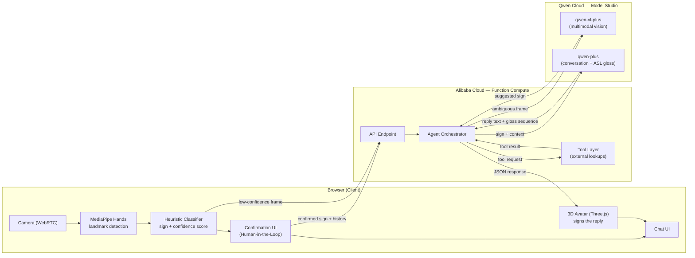

# SignAI

**Bidirectional sign-language communication agent — camera → chat → avatar, powered by Qwen Cloud on Alibaba Cloud.**

Built for the **Global AI Hackathon Series with Qwen Cloud** — **Track 4: Autopilot Agent**

---

## What is SignAI?

SignAI lets a Deaf or hard-of-hearing user have a real conversation with an AI agent entirely through sign language. No typing, on either side.

1. A webcam reads the user's hand signs (processed entirely on-device).
2. The agent confirms what it understood — a human-in-the-loop checkpoint — before acting on it.
3. The agent reasons over the conversation using Qwen models, optionally calling external tools.
4. A 3D avatar signs the reply back to the user.

## Why This Matters

Modern AI assistants assume the user can type and read fluent text. That assumption excludes a huge population:

- An estimated **70 million people** worldwide are part of the signing Deaf community.
- Roughly **80% of Deaf adults** are not fully fluent in written language — for them, a chat box is effectively a foreign-language interface.
- Every major AI assistant today requires exactly the skill this population is least likely to have: fluent typed/read text.

SignAI removes that barrier at both ends of the conversation.

## How It Works



### Walkthrough

1. **Camera & hand tracking (client-side).** MediaPipe Hands runs entirely in the browser — the raw video feed never leaves the user's device.
2. **Sign classification.** A heuristic classifier maps hand landmarks to a candidate sign and a confidence score.
3. **Human-in-the-loop confirmation.** If confidence is high, the user sees "Did you mean: HELLO? ✅ / ✏️" before anything is sent anywhere. If confidence is low, a single frame is sent to the backend for a second opinion.
4. **Agent orchestration (Alibaba Cloud Function Compute).** A lightweight serverless endpoint receives the confirmed sign + conversation history.
5. **Qwen Cloud models.**
   - `qwen-vl-plus` resolves ambiguous frames (multimodal vision) when the client-side classifier wasn't confident.
   - `qwen-plus` generates the conversational reply **and** an ASL gloss sequence, and can request a tool call mid-reasoning.
6. **Tool layer.** When the agent's reasoning calls for outside information (e.g., a lookup), the orchestrator executes the tool and returns the result to the model for a final answer.
7. **Avatar output.** The returned gloss sequence drives the existing Three.js avatar's pose library, which signs the reply back to the user.

## Track 4 (Autopilot Agent) Alignment

| Judging focus | How SignAI addresses it |
|---|---|
| **Ambiguous inputs** | Low-confidence sign classifications are routed to `qwen-vl-plus` for a multimodal second opinion before any action is taken. |
| **Human-in-the-loop checkpoints** | Every recognized sign is confirmed by the user ("Did you mean...?") before it enters the agent's context — the agent never acts on an unconfirmed interpretation. |
| **External tool invocation** | The agent can call an external tool mid-conversation when the user's request requires information outside its own knowledge. |
| **Production-readiness** | Clear client/backend separation, graceful fallback if the Qwen API is unreachable, and a privacy-first design (raw video never leaves the device). |

## Tech Stack

| Layer | Technology |
|---|---|
| Frontend | Vanilla HTML/JS (single-page), MediaPipe Hands, Three.js |
| Hand tracking | `@mediapipe/hands` (client-side) |
| Sign classification | JS heuristics over hand landmarks |
| Backend | Node.js (Express), deployed as an Alibaba Cloud Function Compute HTTP function |
| AI models | Qwen (`qwen-plus`, `qwen-vl-plus`) via Alibaba Cloud Model Studio (DashScope API) |
| Avatar | Three.js, custom rigged humanoid + keyframed ASL pose library |
| Hosting | Alibaba Cloud Function Compute (backend) + static hosting for frontend |

## Project Structure

```
signai/
├── README.md
├── LICENSE                  (MIT)
├── docs/
│   ├── architecture.html    — full technical architecture (this repo's design doc)
│   ├── pitch-deck.html       — project pitch
│   └── research.html         — market research & statistics
├── frontend/
│   └── index.html            — camera, classifier, chat UI, avatar
└── backend/
    ├── index.js               — Function Compute handler (Qwen + tool orchestration)
    ├── package.json
    └── .env.example
```

## Getting Started

### Prerequisites

- A Qwen Cloud account with hackathon credits (Model Studio / DashScope API key)
- An Alibaba Cloud account (Function Compute enabled)
- Node.js 18+

### Local Development

```bash
cd backend
npm install
cp .env.example .env   # add your DASHSCOPE_API_KEY
npm run dev
```

Open `frontend/index.html` in a browser and point it at your local backend URL.

### Deploying to Alibaba Cloud

```bash
# Function Compute deployment via Serverless Devs (s CLI)
s deploy
```

The deployed function URL becomes the backend endpoint the frontend calls.

## Alibaba Cloud Deployment Proof

> Link to the code file demonstrating Alibaba Cloud SDK/API usage: `backend/index.js`
> Proof recording: *(link added at submission time)*

## Demo Video

*(link added at submission time)*

## Roadmap

| Phase | Scope |
|---|---|
| **V0 — Hackathon** | Browser prototype + Alibaba-Cloud-hosted Qwen agent, ~14 signs, confirmation step, one tool |
| **V1 — Closed alpha (+1 month)** | TensorFlow.js classifier (50+ signs), rigged glTF avatar, pilot with Deaf testers |
| **V2 — Public beta (+3 months)** | Continuous-signing model, 200+ signs with ASL grammar, mobile PWA |
| **V3 — Production (+6–12 months)** | Additional sign languages (BSL, RSL), non-manual markers (facial grammar), accessibility-compliance SDK |

## Privacy & Ethics

- **On-device first.** Hand tracking runs in the browser; the raw camera feed never leaves the user's machine.
- **Server only sees structured data.** The backend receives recognized signs/text and conversation history — never video or images, except a single confirmed frame in low-confidence cases.
- **Deaf-led product decisions.** Sign vocabulary, avatar design, and grammar rules are intended to be reviewed by Deaf signers, not decided unilaterally by hearing engineers.
- **No facial recognition.** No identifiable face data is stored — only transient hand landmark vectors.

## License

MIT — see `LICENSE`.
